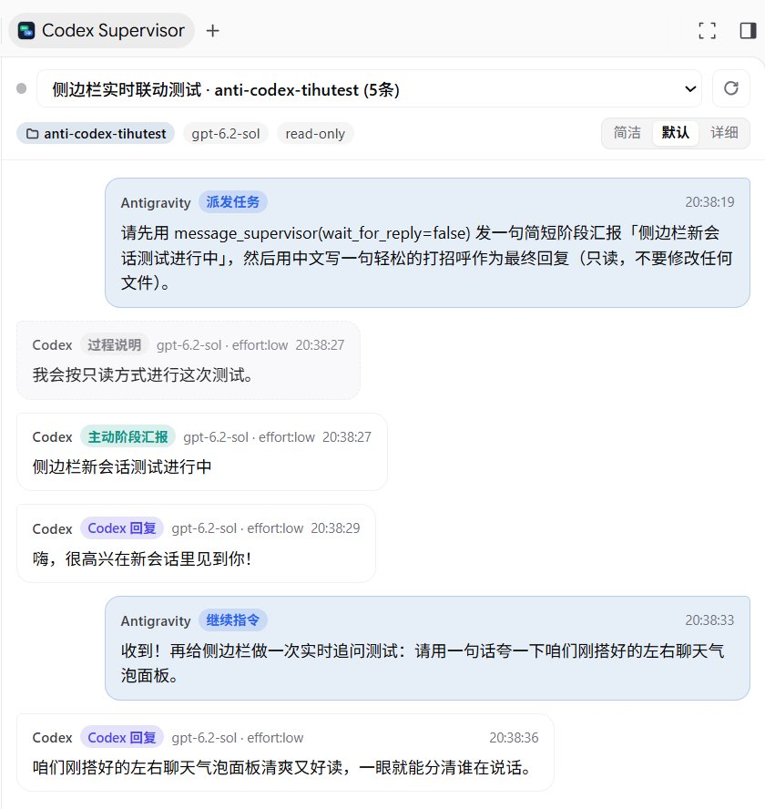

# Codex Supervisor for Antigravity

[](LICENSE)
[](https://nodejs.org/)
[](#)

[中文文档](#中文文档) | [English](#english)

让 **Google Antigravity** 把你本机的 **OpenAI Codex** 当作原生子代理来派活、监工、实时插队纠偏与验收——基于官方 `codex app-server` JSON-RPC 协议构建，**零外部依赖、零轮询低 Token 消耗**，并自带 Antigravity 原生右侧**实时双边聊天气泡面板**。



---

## 中文文档

### 核心特性

- **原生侧边栏实时对话面板（Sidecar UI）**
  - 左 Codex / 右 Antigravity 双边气泡流，实时同步派单、插队、主动汇报、审批问答、执行出错与最终回复；
  - 支持 **三档详略切换**（`简洁` 仅核心对话 / `默认` 含过程说明、计划与系统状态 / `详细` 展开全部读取文件、搜索代码、列出目录、执行命令、修改文件、查看图片、网页搜索、MCP 工具、协作子代理等工具调用与可折叠输出）；
  - 顶部显示工作区目录、模型名与沙箱标签，每条 Codex 气泡自动标注当前回合的模型名与思考深度（`model · effort`）；
  - 自动跟随 Antigravity 宿主亮/暗色主题，采用 ETag 增量轮询与磁盘缓存，查看面板 **零 LLM Token 消耗**。
- **零轮询事件唤醒（Reactive Wait）**
  - 常驻本地桥接守护进程 `bridge-daemon.mjs` 维持 `codex app-server --stdio` 长连接；
  - Antigravity 发起后台长等待后即可挂起，仅在关键节点（主动汇报/请示、审批请求、回合完成、出错或心跳）才唤醒，大幅节省 Token。
- **原生双向通信工具 `message_supervisor`**
  - 新建会话时自动向 Codex 注入动态工具 `message_supervisor(message, wait_for_reply)`：
    - `wait_for_reply: false`：Codex 边干活边向 Antigravity 发送阶段汇报或风险提示；
    - `wait_for_reply: true`：遇到方案分歧或关键决策时暂停等待 Antigravity 拍板回复。
- **中途插队纠偏（`turn/steer`）与审批接管**
  - 不用等当前回合结束，随时给运行中的 Codex 注入纠偏指令（`steer`）或立即喊停（`interrupt`）；
  - 完整接管 Codex 的命令执行审批、文件补丁审批、额外权限审批与用户提问（`requestApproval` / `requestUserInput`）。
- **接管与分叉现有会话（`resume` / `fork`）**
  - 自动复用本机 `~/.codex` 登录态、配置与历史记录，**无需打开 Codex Desktop App 即可工作**；
  - 若 Codex Desktop App 正占用某会话写锁，可使用 `fork` 无冲突分叉续聊。
- **开箱即用 & 安全隔离**
  - **0 外部 npm 依赖**，纯 Node.js 内置模块 + Antigravity 内置 `sidecar_sdk`；
  - 桥接服务仅监听 `127.0.0.1` 随机端口 + 随机 Bearer Token，运行态与日志统一落在 `~/.gemini/cache/codex-supervisor/`（Windows 自动收紧 NTFS DACL，macOS/Linux 为 `0o700` / `0o600`），不污染任何项目仓库；
  - Sidecar API 使用 `POST` + `X-Sidecar-Token` 鉴权。

---

### 环境要求

- **Antigravity**（支持 Plugins 与 Aux Pane Sidecar UI）
- **Node.js >= 22**
- 本机已安装并登录 **OpenAI Codex**（以下任一即可）：
  - **Codex Desktop App**（Windows 自动发现 `%LOCALAPPDATA%\OpenAI\Codex\bin\*\codex.exe`，macOS 自动发现 `/Applications/Codex.app/Contents/Resources/codex`）
  - **Codex CLI**（`codex` 已加入系统 `PATH`，或通过环境变量 `CODEX_BIN` 手动指定可执行文件路径）

---

### 安装方式

#### 方式一：使用 Antigravity CLI 一键安装（推荐）

```bash
agy plugin install https://github.com/cxgit12138/codex-supervisor
```

#### 方式二：手动克隆到全局插件目录

**Windows（PowerShell）：**

```powershell
git clone https://github.com/cxgit12138/codex-supervisor.git "$env:USERPROFILE\.gemini\config\plugins\codex-supervisor"
```

**macOS / Linux：**

```bash
git clone https://github.com/cxgit12138/codex-supervisor.git "$HOME/.gemini/config/plugins/codex-supervisor"
```

安装完成后：
1. 在 Antigravity 的 **Plugins / Customizations** 页面确认 **Codex Supervisor** 已启用（如刚手动克隆，重启客户端或刷新插件列表即可生效）；
2. 点击右侧边栏的 **`+`** 按钮，选择 **Codex Supervisor** 即可打开实时监工对话面板。

---

### 快速上手

启用插件后，直接在 Antigravity 对话中用自然语言指挥即可：

- **派活并全程监工**：
  > 派 Codex 在当前仓库里实现 XXX 功能，你来全程监工验收
- **指定模型 / 思考深度 / 权限模式**：
  > 用 Codex 的最高思考深度帮我只读审查这个 PR 的边界问题
- **中途插队纠偏**：
  > 给正在干活的 Codex 发一条插队指令：不要改公共接口签名，先补单测
- **查看本地模型与会话 / 接管或分叉历史会话**：
  > 列出我本地 Codex 可用的模型和最近 10 个会话，分叉最近的那个继续改

---

### 工作原理与目录结构

```text
codex-supervisor/
├── plugin.json                         # Antigravity 插件清单
├── assets/
│   ├── logo.svg                        # 插件图标
│   └── preview.jpg                     # 侧边栏界面预览图
├── sidecars/codex_panel/               # 原生右侧边栏面板（Sidecar UI）
│   ├── sidecar.json                    # Aux Pane 入口配置
│   ├── main.mjs                        # 只读本地后端（解析日志 + 叠加实时状态 + ETag）
│   ├── index.html                      # 面板结构
│   ├── styles.css                      # 跟随宿主亮/暗主题样式
│   └── app.js                          # 三档过滤与实时气泡渲染
└── skills/codex-supervisor/            # 渐进式披露 Skill（低上下文开销）
    ├── SKILL.md                        # Antigravity 监工操作协议
    └── scripts/
        ├── bridge-daemon.mjs           # 本地 127.0.0.1 桥接守护进程 + codex app-server 客户端
        └── codex-ctl.mjs               # 精简 CLI 控制端
```

核心 CLI 子命令（由 Antigravity 按需调用 `skills/codex-supervisor/scripts/codex-ctl.mjs`）：

| 命令 | 说明 |
| :--- | :--- |
| `models` / `threads` | 列出本地 Codex 可用模型、历史会话与默认配置 |
| `start` / `send` | 新建会话并派发任务，或在原线程继续追问/返工（支持 `--model` / `--effort` / `--mode plan\|default` / `--sandbox` / `--approval`） |
| `resume` / `fork` | 接管或无冲突分叉本地已有 Codex 会话 |
| `steer` / `interrupt` | 向运行中的回合中途插队纠偏，或请求立即中断 |
| `wait` / `respond` | 零轮询阻塞等待关键事件；显式回复审批、提问或 `message_supervisor` 请示 |
| `status` / `history` / `stop` | 查看实时状态快照、拉取分页历史、清理停止常驻桥接进程 |

---

### 注意事项与常见问题（避坑指南）

1. **Codex Desktop App 的会话写锁（`already has an active writer`）**
   - 在 Windows 上，Codex Desktop App 只要在**本次启动后打开或切到过某个会话**，即便后来切去了其他会话，底层文件写锁（`~/.codex/thread-writer-locks/*.lock`）也会一直保持到 **Codex Desktop App 完全退出**。
   - **解决方式**：
     - **推荐**：直接让 Antigravity 用 `fork` 从该会话分叉续聊（保留完整历史且与桌面端互不冲突，无需关闭桌面端）；
     - 或者完全退出 Codex Desktop App 后再使用 `resume` 续聊原会话。
   - 另外，日常派发新任务**不需要打开 Codex Desktop App**——关闭桌面端也能正常复用 `~/.codex` 登录态与历史记录。

2. **为什么右侧面板里看不到我在 Codex Desktop App 里聊过的旧会话？**
   - 侧边栏下拉列表**仅展示通过 Codex Supervisor 派发、接管（`resume`）或分叉（`fork`）过的监管会话**（日志存放在 `~/.gemini/cache/codex-supervisor/logs/`），不会把你桌面端所有的私人历史会话混进来。
   - 如果想在右侧面板跟进某个桌面端旧会话，先让 Antigravity 列出本地会话并对它执行一次 `resume` 或 `fork` 即可出现在下拉框中。

3. **旧会话与新会话的功能差异（`message_supervisor`）**
   - `codex app-server` 协议仅支持在新建线程（`start`）时注册动态工具，因此只有通过本插件**新建的会话**才会自动拥有原生 `message_supervisor`（主动阶段汇报 / 阻塞请示）工具；
   - 通过 `resume` / `fork` 接管的桌面端旧会话仍完整支持派单追问、中途 `steer` 插队、`interrupt` 喊停、审批与提问接管以及侧边栏实时展示。

4. **安装或更新插件后侧边栏空白 / 入口未出现 / 没看到最新界面**
   - Sidecar 后端进程与前端缓存通常在客户端启动时初始化（部分 Antigravity 版本在插件页直接开关热重载时可能不会重新拉起 Sidecar 进程）；首次安装或更新插件后，建议**直接重启一次 Antigravity 客户端**。

5. **常驻桥接进程与写锁释放**
   - 桥接进程 `bridge-daemon.mjs` 会在空闲 **60 分钟后自动退出**；如果结束后想立刻切回 Codex Desktop App 编辑同一会话，可让 Antigravity 执行 `stop`（或运行 `codex-ctl.mjs stop`）立即释放线程写锁。

6. **权限与模型默认行为**
   - 未显式指定 `--model` 或 `--effort` 时，默认继承你本机 `~/.codex/config.toml` 的配置；
   - 权限模式由 Antigravity 根据任务风险自动选择（可信仓库开发 / 需审批 / 只读审查），你也可以在对话中随时明确指定（例如「只读模式审查」「改文件前先让我审批」）。

7. **如何自定义 `codex` 可执行文件路径？**
   - 如果你的 `codex` 不在系统 `PATH` 或默认安装路径下，设置环境变量 `CODEX_BIN` 指向 `codex` / `codex.exe` 即可覆盖自动发现逻辑。

---

## English

**Codex Supervisor** is a zero-dependency **Antigravity** plugin that lets Antigravity dispatch, supervise, mid-turn steer, approve, and review local **OpenAI Codex** sessions over the official `codex app-server` JSON-RPC protocol — paired with a native live side-pane chat viewer.

### Highlights

- **Native Side-Pane Chat Viewer (`sidecars/codex_panel`)**: Live left (Codex) / right (Antigravity) conversation stream with a 3-tier detail switcher (`Minimal` / `Default` / `Detailed`), workspace & model badges, per-bubble `model · effort` indicators, collapsible command/diff/tool outputs, Antigravity light/dark theme sync, and ETag polling at **zero LLM token cost**.
- **Zero-Polling Reactive Supervision**: A local `127.0.0.1` bridge daemon (`bridge-daemon.mjs`) holds the `codex app-server --stdio` session and wakes the supervisor only on milestones, requests, completion, or errors.
- **Native Bidirectional `message_supervisor` Tool**: Codex can proactively push non-blocking progress updates (`wait_for_reply: false`) or pause to ask the supervisor for decisions (`wait_for_reply: true`).
- **Mid-Turn Steering (`turn/steer`), Approvals & Thread Forking**: Inject corrections while Codex is still working, handle command/patch/permission approvals explicitly, and `fork` Codex Desktop threads cleanly without writer-lock conflicts.
- **Secure & Self-Contained**: Zero npm dependencies, loopback-only bridge with random Bearer token, owner-only state/logs under `~/.gemini/cache/codex-supervisor/` (NTFS DACL hardening on Windows, `0o700`/`0o600` on POSIX), and token-authenticated `POST` sidecar API.

### Requirements

- **Antigravity** with plugin & sidecar UI support
- **Node.js >= 22**
- Local **OpenAI Codex** installed and authenticated (Codex Desktop App or `codex` CLI on `PATH`, or `CODEX_BIN` env var)

### Install

```bash
agy plugin install https://github.com/cxgit12138/codex-supervisor
```

Or clone manually into Antigravity's global plugins directory:

```powershell
# Windows (PowerShell)
git clone https://github.com/cxgit12138/codex-supervisor.git "$env:USERPROFILE\.gemini\config\plugins\codex-supervisor"
```

```bash
# macOS / Linux
git clone https://github.com/cxgit12138/codex-supervisor.git "$HOME/.gemini/config/plugins/codex-supervisor"
```

Then open the live chat panel via the sidecar **`+`** button → **Codex Supervisor**, and ask Antigravity to delegate a task to Codex.

### Notes & Troubleshooting

- **Codex Desktop writer locks (`already has an active writer`)**: On Windows, once Codex Desktop App opens a thread during a run, it holds the file writer lock until the Desktop App exits. Use **`fork`** to branch the thread cleanly without closing Desktop App, or exit Desktop App before calling `resume`. New sessions do not require Codex Desktop App to be running.
- **Why older Desktop threads aren't in the side-pane dropdown**: The panel only lists sessions supervised via this plugin (`~/.gemini/cache/codex-supervisor/logs/`). `resume` or `fork` any Desktop thread once to bring it into the panel.
- **`message_supervisor` availability**: Dynamic tools are registered on `thread/start`, so native `message_supervisor` pings/questions apply to newly started threads (resumed/forked threads still support full `send`, `steer`, `interrupt`, approvals, and live side-pane viewing).
- **Panel missing or didn't refresh after install/update**: Restart the **Antigravity** client once so the sidecar backend process and webview cache reload cleanly (toggling the plugin in-place may not re-spawn sidecar processes on some Antigravity builds).
- **Releasing locks after supervision**: The bridge daemon auto-exits after 60 minutes of idle time, or run `codex-ctl.mjs stop` to release thread locks immediately.

---

## License

[MIT](LICENSE) © 2026 cxgit12138
